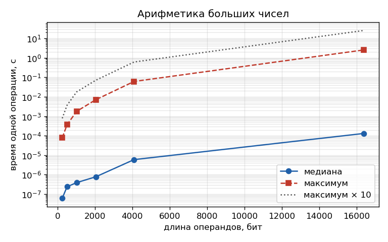

# Арифметика больших чисел — benchmark of the reference

Generated by `make bench CAPSTONE=bigint-arithmetic`; do not edit.

Command: `reference/build/bigint-solver`

Machine: python: 3.11.2, kernel: 6.8.0-142-generic, machine: x86_64, image: capstone-c, cpus_visible: 16, cpu_count: 16, cpu: AMD EPYC 7352 24-Core Processor, mem_total_kb: 32863288, governor: n/a (not exposed), loadavg_1m: 1.42236328125

| size | x | ok/n | timeout | median, s | p90, s | max, s | limit (×10), s | peak RSS, MB |
|---|---|---|---|---|---|---|---|---|
| b256 | 256 | 72/72 | 0 | 0.0246 | 0.0456 | 0.0727 | 0.727 | 1 |
| b512 | 512 | 72/72 | 0 | 0.0297 | 0.0444 | 0.0723 | 0.723 | 2 |
| b1024 | 1024 | 72/72 | 0 | 0.0227 | 0.0379 | 0.0748 | 0.748 | 1 |
| b2048 | 2048 | 72/72 | 0 | 0.0281 | 0.0344 | 0.0629 | 0.629 | 2 |
| b4096 | 4096 | 72/72 | 0 | 0.0284 | 0.049 | 0.0667 | 0.667 | 2 |
| b16384 | 16384 | 30/30 | 0 | 0.00142 | 2.18 | 2.55 | 25.5 | 2 |
| corner128 | — | 80/80 | 0 | 0.0209 | 0.0441 | 0.0842 | 0.842 | 1 |
| corner1024 | — | 80/80 | 0 | 0.0195 | 0.0558 | 0.143 | 1.43 | 2 |
| mul2048 | — | 15/15 | 0 | 0.0326 | 0.0517 | 0.0698 | 0.698 | 2 |
| div2048 | — | 15/15 | 0 | 0.0343 | 0.0353 | 0.0355 | 0.355 | 1 |
| gcd2048 | — | 15/15 | 0 | 0.0296 | 0.0448 | 0.0635 | 0.635 | 2 |
| powmod2048 | — | 12/12 | 0 | 0.0343 | 0.0351 | 0.0352 | 0.352 | 1 |

Derived requirements (`requirements.tex`):

- `\ReqSlack` = 10
- `\ReqBits` = 2048
- `\ReqMulUs` = 50
- `\ReqDivUs` = 50
- `\ReqGcdMs` = 10
- `\ReqPowmodMs` = 100

