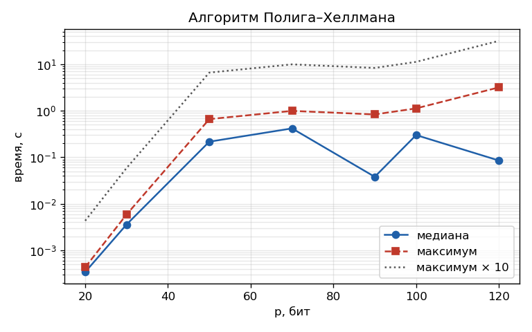

# Алгоритм Полига–Хеллмана — benchmark of the reference

Generated by `make bench CAPSTONE=pohlig-hellman`; do not edit.

Command: `sage -python reference/solver.py`

Machine: python: 3.12.3, kernel: 6.8.0-142-generic, machine: x86_64, image: taskgen, cpus_visible: 16, cpu_count: 16, cpu: AMD EPYC 7352 24-Core Processor, mem_total_kb: 32863288, governor: n/a (not exposed), loadavg_1m: 1.234375

| size | x | ok/n | timeout | median, s | p90, s | max, s | limit (×10), s | peak RSS, MB |
|---|---|---|---|---|---|---|---|---|
| p20 | 20 | 10/10 | 0 | 0.000342 | 0.000419 | 0.000433 | 0.00433 | 13 |
| p30 | 30 | 12/12 | 0 | 0.00359 | 0.00525 | 0.00589 | 0.0589 | 15 |
| p50 | 50 | 12/12 | 0 | 0.217 | 0.656 | 0.662 | 6.62 | 151 |
| p70 | 70 | 12/12 | 0 | 0.418 | 0.839 | 0.996 | 9.96 | 169 |
| p90 | 90 | 12/12 | 0 | 0.0381 | 0.82 | 0.834 | 8.34 | 170 |
| p100 | 100 | 20/20 | 0 | 0.301 | 0.764 | 1.13 | 11.3 | 169 |
| p120 | 120 | 8/8 | 0 | 0.0854 | 3.18 | 3.18 | 31.8 | 529 |

Derived requirements (`requirements.tex`):

- `\ReqSlack` = 10
- `\ReqBitsMin` = 50
- `\ReqBitsMax` = 100
- `\ReqQBitsMax` = 40
- `\ReqSeconds` = 20

