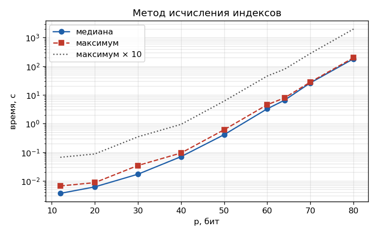

# Метод исчисления индексов — benchmark of the reference

Generated by `make bench CAPSTONE=index-calculus`; do not edit.

Command: `sage -python reference/main.py`

Machine: python: 3.12.3, kernel: 6.8.0-142-generic, machine: x86_64, image: taskgen, cpus_visible: 16, cpu_count: 16, cpu: AMD EPYC 7352 24-Core Processor, mem_total_kb: 32863288, governor: n/a (not exposed), loadavg_1m: 1.11181640625

| size | x | ok/n | timeout | median, s | p90, s | max, s | limit (×10), s | peak RSS, MB |
|---|---|---|---|---|---|---|---|---|
| p12 | 12 | 8/8 | 0 | 0.00367 | 0.00665 | 0.00665 | 0.0665 | 223 |
| p20 | 20 | 10/10 | 0 | 0.00617 | 0.00802 | 0.00869 | 0.0869 | 223 |
| p30 | 30 | 10/10 | 0 | 0.0171 | 0.0201 | 0.0344 | 0.344 | 223 |
| p40 | 40 | 10/10 | 0 | 0.07 | 0.0809 | 0.0937 | 0.937 | 224 |
| p50 | 50 | 10/10 | 0 | 0.409 | 0.556 | 0.608 | 6.08 | 239 |
| p60 | 60 | 10/10 | 0 | 3.27 | 4.23 | 4.55 | 45.5 | 300 |
| p64 | 64 | 6/6 | 0 | 6.51 | 7.85 | 7.85 | 78.5 | 368 |
| p70 | 70 | 4/4 | 0 | 26.3 | 28 | 28 | 280 | 572 |
| p80 | 80 | 2/2 | 0 | 182 | 198 | 198 | 1.98e+03 | 1626 |

Derived requirements (`requirements.tex`):

- `\ReqSlack` = 10
- `\ReqBitsMin` = 50
- `\ReqBitsMax` = 60
- `\ReqSeconds` = 50

