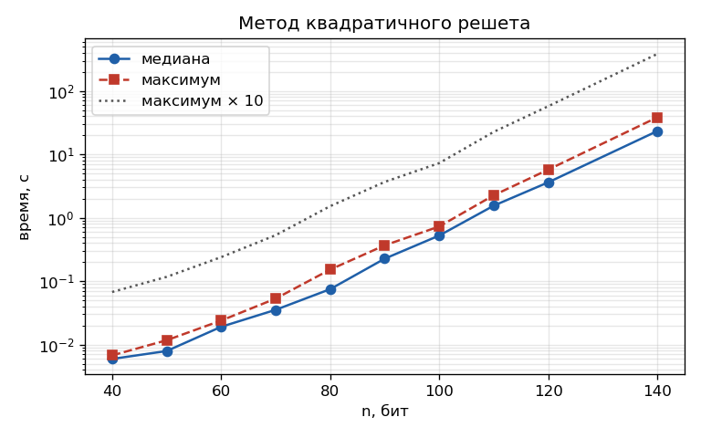

# Метод квадратичного решета — benchmark of the reference

Generated by `make bench CAPSTONE=quadratic-sieve`; do not edit.

Command: `sage -python reference/main.py`

Machine: python: 3.12.3, kernel: 6.8.0-142-generic, machine: x86_64, image: taskgen, cpus_visible: 16, cpu_count: 16, cpu: AMD EPYC 7352 24-Core Processor, mem_total_kb: 32863288, governor: n/a (not exposed), loadavg_1m: 1.09375

| size | x | ok/n | timeout | median, s | p90, s | max, s | limit (×10), s | peak RSS, MB |
|---|---|---|---|---|---|---|---|---|
| n40 | 40 | 10/10 | 0 | 0.00594 | 0.00672 | 0.00675 | 0.0675 | 14 |
| n50 | 50 | 10/10 | 0 | 0.00791 | 0.0115 | 0.0117 | 0.117 | 14 |
| n60 | 60 | 10/10 | 0 | 0.0191 | 0.0214 | 0.0239 | 0.239 | 15 |
| n70 | 70 | 10/10 | 0 | 0.0353 | 0.0441 | 0.0531 | 0.531 | 15 |
| n80 | 80 | 10/10 | 0 | 0.0748 | 0.105 | 0.152 | 1.52 | 15 |
| n90 | 90 | 10/10 | 0 | 0.226 | 0.26 | 0.368 | 3.68 | 15 |
| n100 | 100 | 10/10 | 0 | 0.524 | 0.691 | 0.728 | 7.28 | 16 |
| n110 | 110 | 8/8 | 0 | 1.55 | 2.26 | 2.26 | 22.6 | 17 |
| n120 | 120 | 8/8 | 0 | 3.62 | 5.75 | 5.75 | 57.5 | 19 |
| n140 | 140 | 5/5 | 0 | 23.3 | 38.3 | 38.3 | 383 | 30 |
| corner60 | — | 16/16 | 0 | 0.000321 | 0.0242 | 0.0246 | 0.246 | 15 |
| pp100 | — | 6/6 | 0 | 0.000395 | 0.000505 | 0.000505 | 0.00505 | 14 |
| small100 | — | 4/4 | 0 | 0.00158 | 0.00161 | 0.00161 | 0.0161 | 14 |
| unbal100 | — | 4/4 | 0 | 0.453 | 0.591 | 0.591 | 5.91 | 16 |
| repeat100 | — | 4/4 | 0 | 0.582 | 1.01 | 1.01 | 10.1 | 16 |
| close100 | — | 4/4 | 0 | 0.576 | 0.646 | 0.646 | 6.46 | 16 |
| multi80 | — | 6/6 | 0 | 0.0963 | 0.101 | 0.101 | 1.01 | 15 |
| multi100 | — | 6/6 | 0 | 0.498 | 0.619 | 0.619 | 6.19 | 16 |

Derived requirements (`requirements.tex`):

- `\ReqSlack` = 10
- `\ReqBits` = 100
- `\ReqSeconds` = 10

