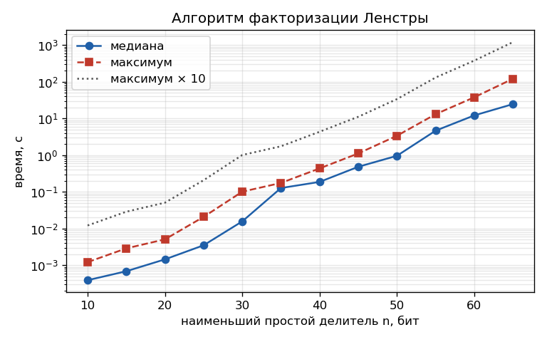

# Алгоритм факторизации Ленстры — benchmark of the reference

Generated by `make bench CAPSTONE=lenstra-ecm`; do not edit.

Command: `sage -python reference/main.py --family weierstrass`

Machine: python: 3.12.3, kernel: 6.8.0-142-generic, machine: x86_64, image: taskgen, cpus_visible: 16, cpu_count: 16, cpu: AMD EPYC 7352 24-Core Processor, mem_total_kb: 32863288, governor: n/a (not exposed), loadavg_1m: 1.08251953125

| size | x | ok/n | timeout | median, s | p90, s | max, s | limit (×10), s | peak RSS, MB |
|---|---|---|---|---|---|---|---|---|
| p10-n20 | 10 | 10/10 | 0 | 0.000389 | 0.000862 | 0.00121 | 0.0121 | 19 |
| p15-n30 | 15 | 10/10 | 0 | 0.000682 | 0.0024 | 0.00287 | 0.0287 | 19 |
| p20-n40 | 20 | 10/10 | 0 | 0.00144 | 0.00451 | 0.00506 | 0.0506 | 19 |
| p25-n50 | 25 | 10/10 | 0 | 0.00348 | 0.019 | 0.0207 | 0.207 | 19 |
| p30-n60 | 30 | 10/10 | 0 | 0.0156 | 0.0512 | 0.101 | 1.01 | 19 |
| p35-n70 | 35 | 10/10 | 0 | 0.127 | 0.168 | 0.175 | 1.75 | 19 |
| p40-n80 | 40 | 10/10 | 0 | 0.186 | 0.4 | 0.435 | 4.35 | 19 |
| p45-n90 | 45 | 10/10 | 0 | 0.482 | 0.966 | 1.11 | 11.1 | 20 |
| p50-n100 | 50 | 16/16 | 0 | 0.961 | 2.55 | 3.38 | 33.8 | 21 |
| p55-n110 | 55 | 8/8 | 0 | 4.65 | 13.1 | 13.1 | 131 | 24 |
| p60-n120 | 60 | 8/8 | 0 | 12.1 | 37.9 | 37.9 | 379 | 26 |
| p65-n130 | 65 | 6/6 | 0 | 24.7 | 121 | 121 | 1.21e+03 | 30 |
| unbalanced-n100 | — | 8/8 | 0 | 0.152 | 0.543 | 0.543 | 5.43 | 19 |
| square-n100 | — | 8/8 | 0 | 0.0144 | 0.151 | 0.151 | 1.51 | 19 |
| power-n100 | — | 6/6 | 0 | 0.000285 | 0.000512 | 0.000512 | 0.00512 | 19 |
| multi-n100 | — | 8/8 | 0 | 0.0489 | 0.296 | 0.296 | 2.96 | 19 |
| prime-n100 | — | 6/6 | 0 | 0.000296 | 0.00135 | 0.00135 | 0.0135 | 19 |

Derived requirements (`requirements.tex`):

- `\ReqSlack` = 10
- `\ReqBitsMin` = 50
- `\ReqBitsMax` = 100
- `\ReqSeconds` = 50

