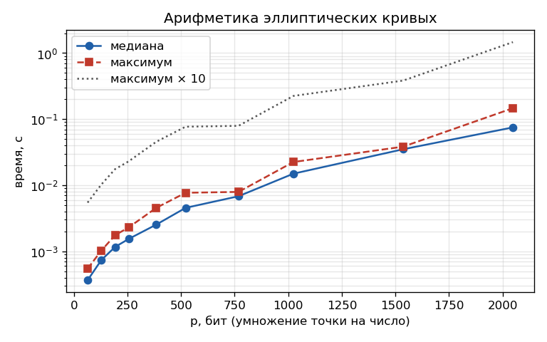

# Арифметика эллиптических кривых — benchmark of the reference

Generated by `make bench CAPSTONE=ec-arithmetic`; do not edit.

Command: `sage -python reference/main.py`

Machine: python: 3.12.3, kernel: 6.8.0-142-generic, machine: x86_64, image: taskgen, cpus_visible: 16, cpu_count: 16, cpu: AMD EPYC 7352 24-Core Processor, mem_total_kb: 32863288, governor: n/a (not exposed), loadavg_1m: 2.24365234375

| size | x | ok/n | timeout | median, s | p90, s | max, s | limit (×10), s | peak RSS, MB |
|---|---|---|---|---|---|---|---|---|
| misc | — | 24/24 | 0 | 0.000185 | 0.000982 | 0.00488 | 0.0488 | 19 |
| add-p64 | — | 10/10 | 0 | 0.000449 | 0.00244 | 0.0025 | 0.025 | 20 |
| add-p256 | — | 10/10 | 0 | 0.00333 | 0.00454 | 0.00466 | 0.0466 | 19 |
| add-p521 | — | 10/10 | 0 | 0.00333 | 0.00538 | 0.00601 | 0.0601 | 19 |
| add-p1024 | — | 10/10 | 0 | 0.0113 | 0.0128 | 0.0131 | 0.131 | 19 |
| add-p2048 | — | 10/10 | 0 | 0.034 | 0.0437 | 0.0456 | 0.456 | 19 |
| mul-p64 | 64 | 12/12 | 0 | 0.000365 | 0.000412 | 0.000545 | 0.00545 | 19 |
| mul-p128 | 128 | 12/12 | 0 | 0.000736 | 0.000935 | 0.00102 | 0.0102 | 19 |
| mul-p192 | 192 | 12/12 | 0 | 0.00116 | 0.00171 | 0.00175 | 0.0175 | 19 |
| mul-p256 | 256 | 12/12 | 0 | 0.00154 | 0.0023 | 0.0023 | 0.023 | 20 |
| mul-p384 | 384 | 12/12 | 0 | 0.00253 | 0.0029 | 0.00454 | 0.0454 | 20 |
| mul-p521 | 521 | 12/12 | 0 | 0.00454 | 0.00665 | 0.00769 | 0.0769 | 20 |
| mul-p768 | 768 | 12/12 | 0 | 0.00681 | 0.00772 | 0.00792 | 0.0792 | 20 |
| mul-p1024 | 1024 | 12/12 | 0 | 0.015 | 0.0157 | 0.0225 | 0.225 | 20 |
| mul-p1536 | 1536 | 12/12 | 0 | 0.035 | 0.0379 | 0.0383 | 0.383 | 20 |
| mul-p2048 | 2048 | 12/12 | 0 | 0.075 | 0.0791 | 0.147 | 1.47 | 19 |
| point-p64 | — | 8/8 | 0 | 0.000346 | 0.00127 | 0.00127 | 0.0127 | 19 |
| point-p256 | — | 8/8 | 0 | 0.000473 | 0.00167 | 0.00167 | 0.0167 | 20 |
| point-p521 | — | 8/8 | 0 | 0.0015 | 0.0117 | 0.0117 | 0.117 | 20 |
| point-p1024 | — | 8/8 | 0 | 0.00694 | 0.0502 | 0.0502 | 0.502 | 20 |
| point-p2048 | — | 8/8 | 0 | 0.0406 | 0.468 | 0.468 | 4.68 | 20 |
| sm-p32 | — | 8/8 | 0 | 0.00213 | 0.00226 | 0.00226 | 0.0226 | 20 |
| sm-p48 | — | 8/8 | 0 | 0.0194 | 0.0226 | 0.0226 | 0.226 | 20 |
| sm-p64 | — | 8/8 | 0 | 0.318 | 0.373 | 0.373 | 3.73 | 48 |
| sm-p72 | — | 6/6 | 0 | 1.7 | 1.78 | 1.78 | 17.8 | 146 |
| sm-p80 | — | 4/4 | 0 | 7.06 | 8.47 | 8.47 | 84.7 | 524 |
| schoof-p32 | — | 6/6 | 0 | 0.268 | 0.343 | 0.343 | 3.43 | 20 |
| schoof-p64 | — | 4/4 | 0 | 3.59 | 3.9 | 3.9 | 39 | 20 |
| schoof-p96 | — | 3/3 | 0 | 14.8 | 15.4 | 15.4 | 154 | 21 |
| schoof-p128 | — | 2/2 | 0 | 44.9 | 54.3 | 54.3 | 543 | 23 |

Derived requirements (`requirements.tex`):

- `\ReqSlack` = 10
- `\ReqBitsMin` = 512
- `\ReqBitsMax` = 1024
- `\ReqAddUs` = 200
- `\ReqMulMs` = 500
- `\ReqPointMs` = 1000
- `\ReqOrderBits` = 64
- `\ReqOrderSeconds` = 5

