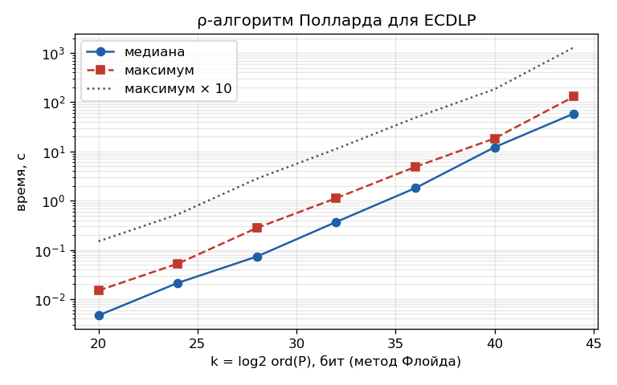

# ρ-алгоритм Полларда для ECDLP — benchmark of the reference

Generated by `make bench CAPSTONE=pollard-rho-ecdlp`; do not edit.

Command: `sage -python reference/main.py`

Machine: python: 3.12.3, kernel: 6.8.0-142-generic, machine: x86_64, image: taskgen, cpus_visible: 16, cpu_count: 16, cpu: AMD EPYC 7352 24-Core Processor, mem_total_kb: 32863288, governor: n/a (not exposed), loadavg_1m: 1.20654296875

| size | x | ok/n | timeout | median, s | p90, s | max, s | limit (×10), s | peak RSS, MB |
|---|---|---|---|---|---|---|---|---|
| n20 | 20 | 20/20 | 0 | 0.00466 | 0.0141 | 0.0149 | 0.149 | 18 |
| n24 | 24 | 20/20 | 0 | 0.0213 | 0.0494 | 0.0524 | 0.524 | 18 |
| n28 | 28 | 10/10 | 0 | 0.0733 | 0.208 | 0.279 | 2.79 | 18 |
| n32 | 32 | 10/10 | 0 | 0.369 | 1.07 | 1.12 | 11.2 | 18 |
| n36 | 36 | 8/8 | 0 | 1.8 | 4.86 | 4.86 | 48.6 | 18 |
| n40 | 40 | 6/6 | 0 | 12.2 | 18.4 | 18.4 | 184 | 18 |
| n44 | 44 | 3/3 | 0 | 58.7 | 130 | 130 | 1.3e+03 | 18 |
| dp20 | — | 20/20 | 0 | 0.00649 | 0.0123 | 0.0132 | 0.132 | 18 |
| dp28 | — | 10/10 | 0 | 0.0465 | 0.0568 | 0.0729 | 0.729 | 18 |
| dp36 | — | 8/8 | 0 | 1.32 | 1.85 | 1.85 | 18.5 | 18 |
| dp40 | — | 6/6 | 0 | 4.34 | 7.32 | 7.32 | 73.2 | 18 |
| dp44 | — | 3/3 | 0 | 6.53 | 31.9 | 31.9 | 319 | 18 |
| p64-n32 | — | 5/5 | 0 | 1.26 | 2.87 | 2.87 | 28.7 | 18 |
| p100-n32 | — | 5/5 | 0 | 2.36 | 5.45 | 5.45 | 54.5 | 18 |
| ord32 | — | 10/10 | 0 | 0.00279 | 0.00327 | 0.00333 | 0.0333 | 18 |
| ord48 | — | 10/10 | 0 | 0.0535 | 0.0629 | 0.0635 | 0.635 | 19 |
| ord64 | — | 5/5 | 0 | 0.825 | 1.44 | 1.44 | 14.4 | 50 |

Derived requirements (`requirements.tex`):

- `\ReqSlack` = 10
- `\ReqPBitsLo` = 50
- `\ReqPBitsHi` = 100
- `\ReqOrderBits` = 40
- `\ReqSeconds` = 200

