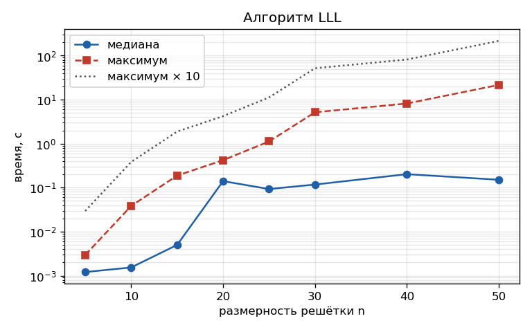

# Алгоритм LLL — benchmark of the reference

Generated by `make bench CAPSTONE=lll`; do not edit.

Command: `sage -python reference/main.py`

Machine: python: 3.12.3, kernel: 6.8.0-142-generic, machine: x86_64, image: taskgen, cpus_visible: 16, cpu_count: 16, cpu: AMD EPYC 7352 24-Core Processor, mem_total_kb: 32863288, governor: n/a (not exposed), loadavg_1m: 1.05029296875

| size | x | ok/n | timeout | median, s | p90, s | max, s | limit (×10), s | peak RSS, MB |
|---|---|---|---|---|---|---|---|---|
| gauss | — | 30/30 | 0 | 0.000285 | 0.00408 | 0.00603 | 0.0603 | 19 |
| check | — | 30/30 | 0 | 0.00025 | 0.000361 | 0.000594 | 0.00594 | 18 |
| corner | — | 36/36 | 0 | 0.00111 | 0.0155 | 0.027 | 0.27 | 19 |
| cong | — | 12/12 | 0 | 0.000681 | 0.00507 | 0.00532 | 0.0532 | 19 |
| knap16 | — | 8/8 | 0 | 0.00819 | 0.0114 | 0.0114 | 0.114 | 19 |
| knap32 | — | 8/8 | 0 | 0.071 | 0.0786 | 0.0786 | 0.786 | 20 |
| knap48 | — | 8/8 | 0 | 0.221 | 0.321 | 0.321 | 3.21 | 21 |
| knap64 | — | 6/6 | 0 | 0.41 | 0.751 | 0.751 | 7.51 | 24 |
| lll5 | 5 | 10/10 | 0 | 0.00121 | 0.00252 | 0.00296 | 0.0296 | 19 |
| lll10 | 10 | 10/10 | 0 | 0.00154 | 0.0279 | 0.0384 | 0.384 | 19 |
| lll15 | 15 | 10/10 | 0 | 0.005 | 0.104 | 0.188 | 1.88 | 19 |
| lll20 | 20 | 10/10 | 0 | 0.141 | 0.288 | 0.422 | 4.22 | 19 |
| lll25 | 25 | 10/10 | 0 | 0.0932 | 0.344 | 1.12 | 11.2 | 19 |
| lll30 | 30 | 16/16 | 0 | 0.118 | 3.02 | 5.17 | 51.7 | 20 |
| lll40 | 40 | 12/12 | 0 | 0.203 | 4.06 | 8.17 | 81.7 | 20 |
| lll50 | 50 | 10/10 | 0 | 0.151 | 0.705 | 21.7 | 217 | 21 |

Derived requirements (`requirements.tex`):

- `\ReqSlack` = 10
- `\ReqDim` = 30
- `\ReqBits` = 128
- `\ReqSeconds` = 100
- `\ReqKnapN` = 48
- `\ReqKnapSeconds` = 5

