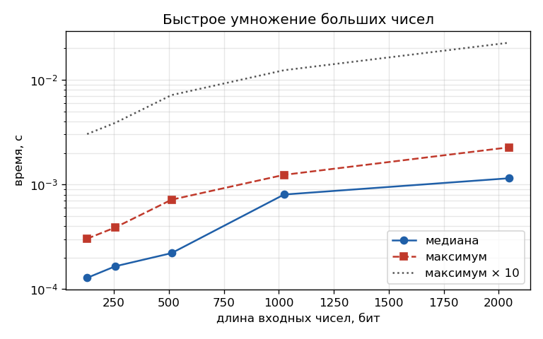

# Быстрое умножение больших чисел — benchmark of the reference

Generated by `make bench CAPSTONE=fast-multiplication`; do not edit.

Command: `sage -python reference/main.py`

Machine: python: 3.12.3, kernel: 7.0.0-43-generic, machine: x86_64, image: taskgen, cpus_visible: 8, cpu_count: 8, cpu: AMD EPYC 7352 24-Core Processor, mem_total_kb: 32860800, governor: n/a (not exposed), loadavg_1m: 0.611328125

| size | x | ok/n | timeout | median, s | p90, s | max, s | limit (×10), s | peak RSS, MB |
|---|---|---|---|---|---|---|---|---|
| b128 | 128 | 12/12 | 0 | 0.000128 | 0.000262 | 0.000303 | 0.00303 | 206 |
| b256 | 256 | 12/12 | 0 | 0.000165 | 0.000358 | 0.000388 | 0.00388 | 205 |
| b512 | 512 | 12/12 | 0 | 0.000221 | 0.000273 | 0.000715 | 0.00715 | 205 |
| b1024 | 1024 | 12/12 | 0 | 0.000801 | 0.00123 | 0.00124 | 0.0124 | 206 |
| b2048 | 2048 | 12/12 | 0 | 0.00115 | 0.00137 | 0.00226 | 0.0226 | 206 |

Derived requirements (`requirements.tex`):

- `\ReqSlack` = 10
- `\ReqBitsMax` = 2048
- `\ReqSeconds` = 0{,}05

