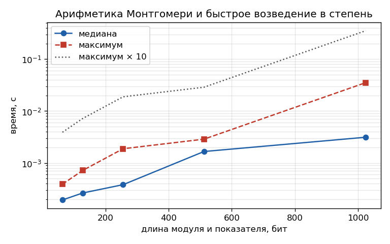

# Арифметика Монтгомери и быстрое возведение в степень — benchmark of the reference

Generated by `make bench CAPSTONE=montgomery-exponentiation`; do not edit.

Command: `sage -python reference/main.py`

Machine: python: 3.12.3, kernel: 7.0.0-43-generic, machine: x86_64, image: taskgen, cpus_visible: 8, cpu_count: 8, cpu: AMD EPYC 7352 24-Core Processor, mem_total_kb: 32860800, governor: n/a (not exposed), loadavg_1m: 0.37353515625

| size | x | ok/n | timeout | median, s | p90, s | max, s | limit (×10), s | peak RSS, MB |
|---|---|---|---|---|---|---|---|---|
| b64 | 64 | 16/16 | 0 | 0.000194 | 0.000339 | 0.000391 | 0.00391 | 12 |
| b128 | 128 | 16/16 | 0 | 0.000265 | 0.000695 | 0.000719 | 0.00719 | 12 |
| b256 | 256 | 16/16 | 0 | 0.000382 | 0.00158 | 0.00188 | 0.0188 | 12 |
| b512 | 512 | 16/16 | 0 | 0.00166 | 0.00279 | 0.00288 | 0.0288 | 12 |
| b1024 | 1024 | 16/16 | 0 | 0.00313 | 0.0115 | 0.0352 | 0.352 | 12 |

Derived requirements (`requirements.tex`):

- `\ReqSlack` = 10
- `\ReqBitsMax` = 1024
- `\ReqSeconds` = 0{,}5

