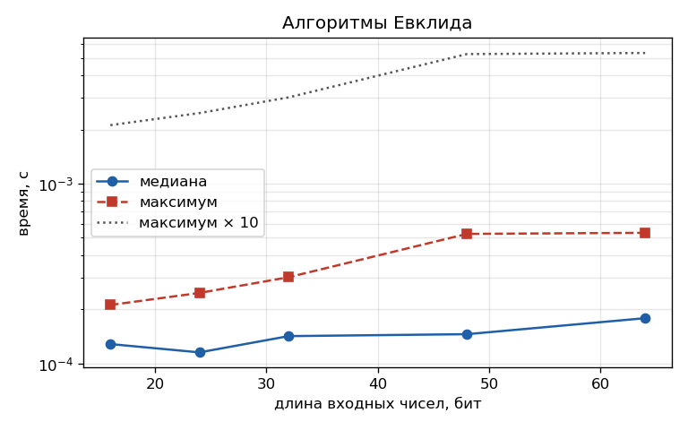

# Алгоритмы Евклида — benchmark of the reference

Generated by `make bench CAPSTONE=euclid-orders-primitive-roots`; do not edit.

Command: `sage -python reference/main.py`

Machine: python: 3.12.3, kernel: 7.0.0-43-generic, machine: x86_64, image: taskgen, cpus_visible: 8, cpu_count: 8, cpu: AMD EPYC 7352 24-Core Processor, mem_total_kb: 32860800, governor: n/a (not exposed), loadavg_1m: 0.3212890625

| size | x | ok/n | timeout | median, s | p90, s | max, s | limit (×10), s | peak RSS, MB |
|---|---|---|---|---|---|---|---|---|
| b16 | 16 | 18/18 | 0 | 0.000128 | 0.000202 | 0.000212 | 0.00212 | 12 |
| b24 | 24 | 18/18 | 0 | 0.000115 | 0.000191 | 0.000247 | 0.00247 | 12 |
| b32 | 32 | 18/18 | 0 | 0.000142 | 0.000191 | 0.000302 | 0.00302 | 12 |
| b48 | 48 | 18/18 | 0 | 0.000146 | 0.000214 | 0.000525 | 0.00525 | 12 |
| b64 | 64 | 18/18 | 0 | 0.000179 | 0.000467 | 0.000533 | 0.00533 | 12 |

Derived requirements (`requirements.tex`):

- `\ReqSlack` = 10
- `\ReqBitsMax` = 64
- `\ReqSeconds` = 0{,}01

