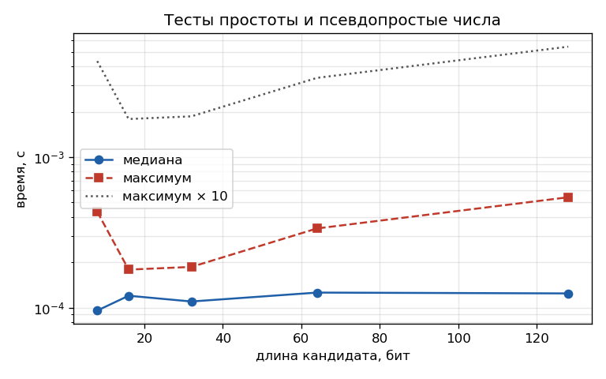

# Тесты простоты и псевдопростые числа — benchmark of the reference

Generated by `make bench CAPSTONE=primality-testing`; do not edit.

Command: `sage -python reference/main.py`

Machine: python: 3.12.3, kernel: 7.0.0-43-generic, machine: x86_64, image: taskgen, cpus_visible: 8, cpu_count: 8, cpu: AMD EPYC 7352 24-Core Processor, mem_total_kb: 32860800, governor: n/a (not exposed), loadavg_1m: 0.529296875

| size | x | ok/n | timeout | median, s | p90, s | max, s | limit (×10), s | peak RSS, MB |
|---|---|---|---|---|---|---|---|---|
| b8 | 8 | 21/21 | 0 | 9.57e-05 | 0.000186 | 0.000434 | 0.00434 | 12 |
| b16 | 16 | 21/21 | 0 | 0.00012 | 0.000135 | 0.000179 | 0.00179 | 12 |
| b32 | 32 | 21/21 | 0 | 0.00011 | 0.000155 | 0.000187 | 0.00187 | 12 |
| b64 | 64 | 21/21 | 0 | 0.000126 | 0.000228 | 0.000336 | 0.00336 | 12 |
| b128 | 128 | 21/21 | 0 | 0.000124 | 0.000403 | 0.000541 | 0.00541 | 12 |

Derived requirements (`requirements.tex`):

- `\ReqSlack` = 10
- `\ReqBitsMax` = 128
- `\ReqSeconds` = 0{,}01

