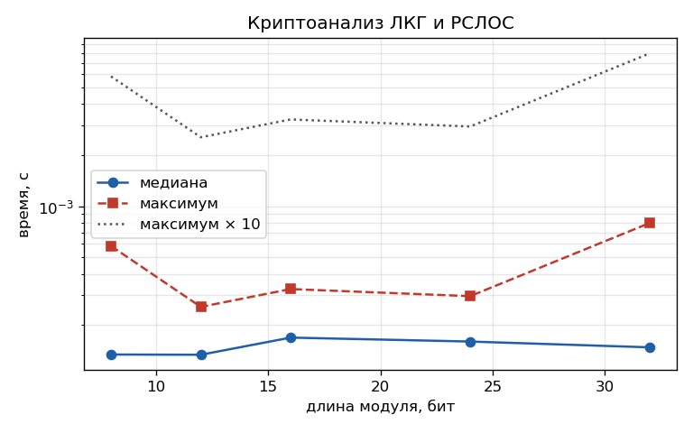

# Криптоанализ ЛКГ и РСЛОС — benchmark of the reference

Generated by `make bench CAPSTONE=lcg-lfsr-cryptanalysis`; do not edit.

Command: `sage -python reference/main.py`

Machine: python: 3.12.3, kernel: 7.0.0-43-generic, machine: x86_64, image: taskgen, cpus_visible: 8, cpu_count: 8, cpu: AMD EPYC 7352 24-Core Processor, mem_total_kb: 32860800, governor: n/a (not exposed), loadavg_1m: 0.28076171875

| size | x | ok/n | timeout | median, s | p90, s | max, s | limit (×10), s | peak RSS, MB |
|---|---|---|---|---|---|---|---|---|
| b8 | 8 | 20/20 | 0 | 0.000134 | 0.000214 | 0.000584 | 0.00584 | 12 |
| b12 | 12 | 20/20 | 0 | 0.000133 | 0.000212 | 0.000255 | 0.00255 | 12 |
| b16 | 16 | 20/20 | 0 | 0.000168 | 0.000205 | 0.000325 | 0.00325 | 12 |
| b24 | 24 | 20/20 | 0 | 0.000159 | 0.000271 | 0.000295 | 0.00295 | 12 |
| b32 | 32 | 20/20 | 0 | 0.000147 | 0.000187 | 0.000798 | 0.00798 | 12 |

Derived requirements (`requirements.tex`):

- `\ReqSlack` = 10
- `\ReqBitsMax` = 32
- `\ReqSeconds` = 0{,}01

